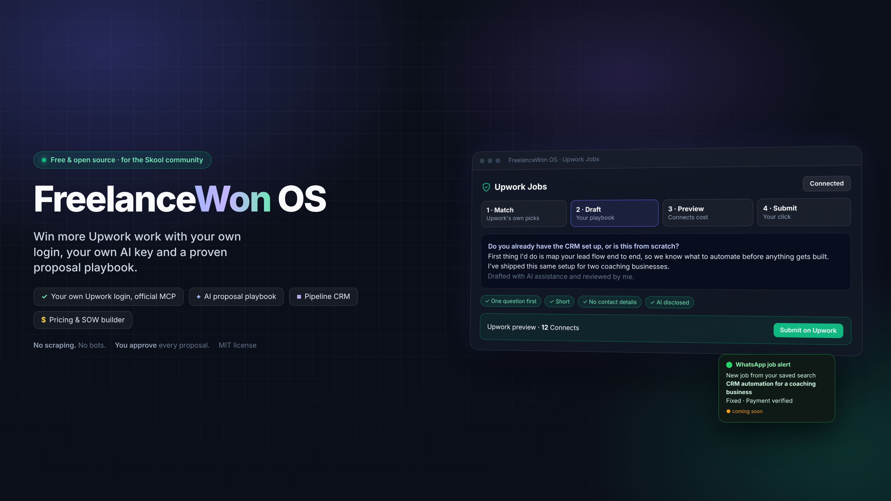
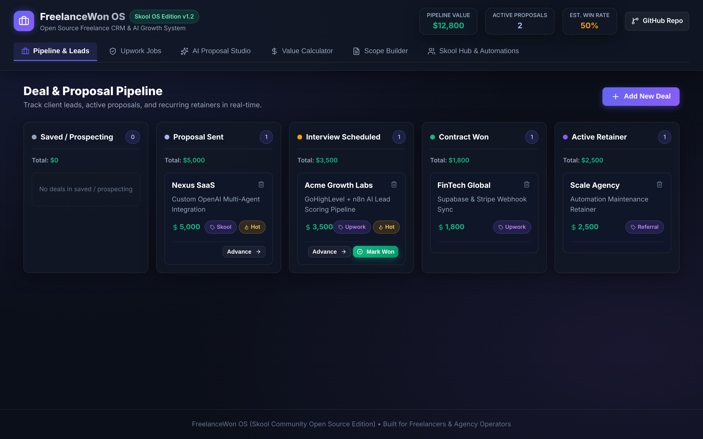

# FreelanceWon OS (Open Source Edition for Skool Community) ⚡

[](https://opensource.org/licenses/MIT)
[]()
[]()



**FreelanceWon OS** is a free, open-source Freelance CRM, Proposal Generator, and AI Growth Engine designed specifically for freelancers, agency operators, and high-ticket service providers in the **Skool Community**.

---

## 🚀 Key Features

- **🌐 Live Web App Demo**: Experience FreelanceWon OS live right now at [https://freelancewon-os.pages.dev](https://freelancewon-os.pages.dev)
- **🛡️ Upwork Jobs (official Upwork MCP)**: Connect your own Upwork account, load Upwork's own job matches, search, or paste any Upwork job link. Draft a proposal with your AI key or write it yourself, review Upwork's preview with the Connects cost, and submit it yourself. No scraping, no bots, nothing sent without your click.
- **🧭 Proposal playbook**: The playbook AutomateScale uses on its own Upwork bids, in [`playbook/proposal-playbook.md`](./playbook/proposal-playbook.md). Pick a **Full proposal** (one diagnostic question, 3 to 6 short lines, your proof link) or a **Quick note** (1 to 3 sentences). Every draft is checked before it goes to Upwork: contact details are blocked, and em dashes, prices in the letter and throat-clearing are flagged.
- **🔔 WhatsApp job alerts (coming soon)**: Save a search and get new jobs from it on your WhatsApp. Built and in the code, switched off until scheduled searches are confirmed with Upwork.
- **📊 Deal & Proposal Pipeline**: Interactive Kanban board to track leads from prospecting → proposal sent → interview → contract won → retainer.
- **✍️ AI Proposal Studio**: Generate high-converting Upwork proposals and direct outreach pitches using 3 battle-tested frameworks (The Upwork Hook & Proof, The Audit & Micro-Video Pitch, and The 3-Step Guarantee).
- **💰 Value-Based Pricing Calculator**: Stop undercharging hourly. Calculate your rate floor, value-based pricing anchors, and monthly retainer structures.
- **📜 Scope of Work (SOW) Builder**: Generate clear, legal-grade Scope of Work documents with milestone payment breakdowns and scope creep defense clauses.
- **🎓 Skool Hub & Automation Kit**: Download pre-configured n8n workflows (`.json`), access high-converting AI prompts, and get started in minutes.



---

## 📦 Quickstart & Installation

### Option 1: Run Locally (needed for Upwork Jobs)

You need Node.js 20 or newer.

```bash
# 1. Clone the repository
git clone https://github.com/AutomateScale/freelancewon-os.git
cd freelancewon-os

# 2. Install dependencies
npm install

# 3. Add your AI key (Anthropic or OpenAI) for proposal drafts
cp .env.example .env    # then edit .env

# 4. Build and start
npm start
```

Open `http://127.0.0.1:8787`, go to **Upwork Jobs** and click **Connect Upwork**. You sign in on upwork.com with your own account; FreelanceWon never sees your password.

Working on the code? Run `npm run server` in one terminal and `npm run dev` in another, and set `APP_URL=http://localhost:5173/?upwork=connected` in `.env`.

---

### Option 2: Deploy to Vercel / Netlify / Cloudflare Pages

The Pipeline, Proposal Studio, Pricing, Scope and Skool tabs are a static Vite + React app you can deploy for FREE on Vercel, Netlify, or Cloudflare Pages. **Upwork Jobs only works when you run it locally (Option 1)**, because it signs in with your own Upwork account through the local server.

1. Fork this repository on GitHub.
2. Link your repo to **Vercel** or **Netlify**.
3. Build command: `npm run build` | Output directory: `dist`.

---

## 🛡️ How Upwork Jobs stays within Upwork's rules

Upwork Jobs uses only Upwork's official MCP server (`https://mcp.upwork.com/mcp`) and follows the [Upwork API & MCP Terms of Use](https://www.upwork.com/legal). Connecting your account means you accept those terms too, so here is what the app does and doesn't do:

- **Your own login, official tools only.** No scraping, RSS feeds, browser automation or shared accounts (Terms 5.2).
- **You start every search.** Nothing polls Upwork in the background (Terms 4.1). WhatsApp job alerts are switched off by default until Upwork confirms scheduled searches are fine; when on, they are capped at 3 of your own saved searches, 10 results each, once an hour, and send only the title, budget, client basics and link.
- **Upwork ranks the jobs, not our AI.** "Best matches" and "Most recent" are Upwork's own recommendations; "Search" uses your words and filters. The AI never scores or filters jobs for you (Terms 5.9).
- **You approve every proposal.** The AI drafts a proposal only for a job you picked. Upwork then shows a preview with the Connects cost, and nothing is submitted until you click "Submit on Upwork" (Terms 5.8, 5.9).
- **AI-assisted proposals are disclosed.** A short "Drafted with AI assistance and reviewed by me." line is added by default (Terms 9.7).
- **Job data isn't stored.** Jobs stay in the open browser tab only. The pipeline keeps just the job titles you choose to add (Terms 8.3, 8.6).
- **Use a paid AI API key.** Job postings go to the AI provider you configure for drafting only. Use a provider and plan that doesn't train on your API data (Anthropic or OpenAI APIs); free tiers may (Terms 5.3).
- **No contact details before a contract.** Emails and phone numbers in a proposal are blocked before it reaches Upwork (Upwork Terms of Service).
- **Activity log.** Every proposal preview and submission is logged in `~/.freelancewon/activity.log` (Terms 10.6).
- **Not affiliated with Upwork.** FreelanceWon OS is an independent open-source tool, not endorsed or certified by Upwork (Terms 5.12).

**Privacy.** FreelanceWon OS runs on your computer. Your Upwork sign-in token is saved in `~/.freelancewon/upwork-token.json` (readable only by you) and is used only to call Upwork. Your "About me" text and pipeline are saved in your browser. Job details go to your AI provider only when you click "Draft with AI". If you turn on job alerts, `~/.freelancewon/` also holds your saved searches and the ids of jobs already sent to you (deleted after 7 days), and each alert's text goes through the WhatsApp service you chose. Click **Disconnect** to revoke the token and delete it; delete `~/.freelancewon/` and your browser's site data to remove everything.

---

## 🧭 Make the playbook yours

`playbook/proposal-playbook.md` is sent to your AI provider with every draft as your own style rules. It ships with the rules AutomateScale uses on its own Upwork bids:

- **Full proposal:** open with one question about the client's setup they can answer in one sentence, then 3 to 6 short lines: your first step, your closest real proof, your proof page link, a reply on Upwork.
- **Quick note:** 1 to 3 sentences under 75 words, a blunt question, a casual close. No links.
- **Voice:** peer to peer, short sentences, no em dashes, no "Dear Hiring Manager", no price or hours in the letter.
- **Never:** invent results, skip the client's required opening words, share contact details, or boost.

Edit the file to sound like you. Set `PLAYBOOK_FILE` in `.env` to keep yours somewhere else.

---

## 🤖 Open Source Automations & Prompts

Inside the [`/automations`](./automations) directory, you will find:
- **`n8n_freelancewon_lead_sync.json`**: An n8n workflow that ingests lead webhooks, qualifies leads using OpenAI GPT-4o, and stores them in your database.

Inside the [`/prompts`](./prompts) directory, you will find:
- **`upwork_proposal_prompts.json`**: Battle-tested AI prompts for Upwork proposal writing, rate objection handling, and scope defense.

---

## 🤝 Community & Support

Built with ❤️ by **Adam Palmer (AutomateScale)** for the **Skool Freelancer Community**.

- Join the discussion in our **Skool Community**
- Submit bug reports or feature requests via GitHub Issues.

---

## 📄 License

This project is licensed under the [MIT License](./LICENSE). You are free to use, modify, self-host, or white-label this software for your business.
